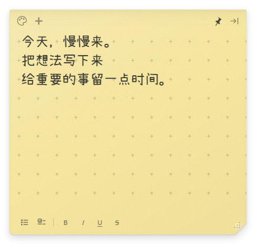
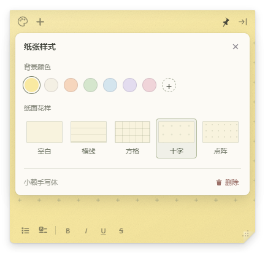

# 纸间便签

Windows 桌面手写便签，使用 Tauri 2、TypeScript 和小赖字体。

[下载 Windows 版](https://github.com/CaesarWANG54/paper-sticky/releases/latest)



- 独立纸张窗口、置顶切换、拖动和缩放。
- 主屏幕右侧贴边收纳，悬停预览，点击取回。
- 七种预设颜色与自定义颜色。
- 空白、横线、方格、十字、点阵，可按便签单独设置。
- 本地自动保存文字、颜色、纸面样式和窗口位置；保存前保留上一份备份。
- 支持中文输入法、纯文本粘贴、待办勾选和基础文字格式。
- 开机启动默认关闭，可从系统托盘菜单启用。

## 使用

安装安装版，或解压免安装版后运行 paper-sticky.exe。需要 Windows x64 和 WebView2 运行时。详见同目录“使用说明.txt”。

点击左上角调色盘选择背景颜色和纸面花样。拖住顶部空白处移动便签，拖到主屏右边缘收纳。



数据默认保存在 `%APPDATA%\com.caesar.papersticky\notes.json`，备份为 `notes.json.bak`。

## 开发

需要 Node.js 22+、Rust MSVC、Visual Studio C++ Build Tools 和 WebView2。

```powershell
npm ci
npm run tauri dev
npm run tauri build
```

## 检查

```powershell
npm test
npm run lint
npm run build
cargo fmt --manifest-path src-tauri/Cargo.toml --check
cargo clippy --manifest-path src-tauri/Cargo.toml --all-targets -- -D warnings
cargo test --manifest-path src-tauri/Cargo.toml --lib
```

`scripts/verify_windows.py` 验证真实 Windows 窗口，使用独立的测试数据目录和临时 WebView2 调试端口。测试记录在 `.qa/`，不随成品分发。

## 来源与许可

窗口、侧边收纳和编辑器基于 [Cute Sticky](https://github.com/SrinjoyDev/cute-sticky)，遵循 MIT；纸张表现参考 [Stickato](https://github.com/curisama/stickato-notes)（MIT）。

内置 [小赖字体 v3.126](https://github.com/lxgw/kose-font) 为未修改的字体文件，遵循 SIL OFL 1.1。完整声明随程序保存在 `licenses/`。
